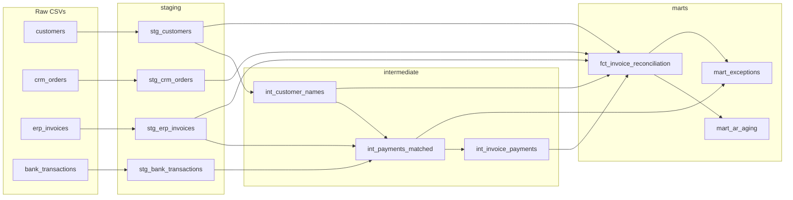
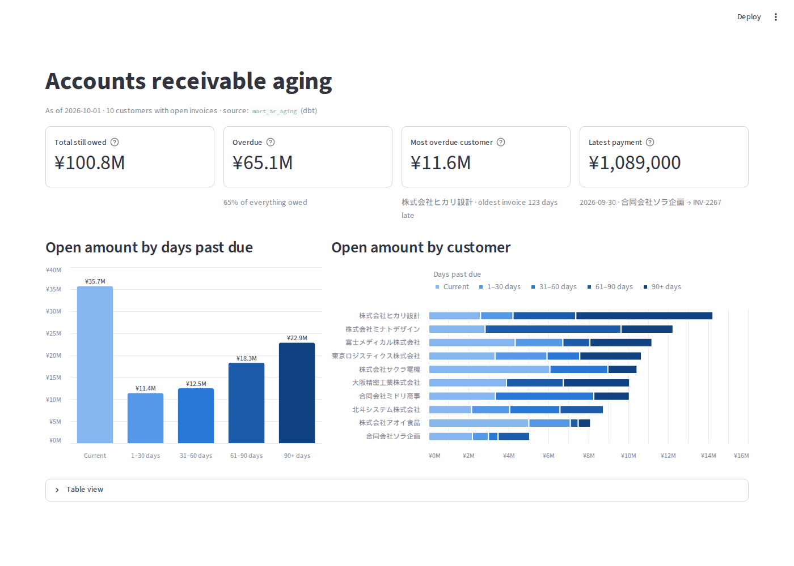

# Japanese Order-to-Cash Reconciliation (dbt + DuckDB)

[](https://github.com/davidkurland94-lgtm/jp-order-to-cash-reconciliation/actions/workflows/dbt-ci.yml)
[](https://davidkurland94-lgtm.github.io/jp-order-to-cash-reconciliation/)

A dbt project that answers the question every finance team asks at month end: **"Did we get paid for everything we billed, and if not, what needs chasing?"**

In this project, there is a reconciliation of  three systems that never quite agree, for a FICTIONAL Japanese B2B company:

| Source | What it records | Typical pain points |
|---|---|---|
| **CRM** (Salesforce-style) | Orders sales closed | Short customer names, orders that never get invoiced |
| **ERP** (Visma-style or any other ERP) | Invoices finance issued | `株式会社` typed as `㈱`, amounts that differ from the order |
| **Bank** (全銀-style transfers) | Money that actually arrived | Half-width katakana payer names (`ｶ)ｻｸﾗﾃﾞﾝｷ`), deducted transfer fees, no invoice number in the memo |

The output is three tables a finance team can take action on: a per-invoice reconciliation, an **accounts-receivable aging report (売掛金年齢表)**, and an **exceptions list** with a suggested next step for each item.

## Lineage



The interactive version, with every column documented, is on the hosted **[dbt docs site](https://davidkurland94-lgtm.github.io/jp-order-to-cash-reconciliation/)**.

## How payments get matched

`int_payments_matched` attempts to match payments to their invoices by order of certain rules. When one rule doesn't match, the next rule is tried.

1. **Memo:** the bank memo contains an invoice number (`INV-2042`).
2. **Amount:** the payment equals exactly one open invoice's amount.
3. **Customer:** the payer name resolves to a customer, and the payment equals one of that customer's invoices, or falls short by up to a bank transfer fee (≤ ¥880).
4. Anything left is `unmatched` and goes to the exceptions list for a person to investigate.

Names are resolved through `int_customer_names`, a lookup of every way each customer gets written (official name, `㈱` form, sales short name, bank katakana name), mapped to one `customer_id`.

## Japan-specific rules

- **振込手数料 (bank transfer fees):** Japanese customers often deduct the transfer fee from what they pay. A shortfall of up to `max_bank_fee_jpy` counts as **settled** (`paid_fee_deducted`), and the fee is reported in `bank_fee_jpy` to be booked as an expense (支払手数料), not chased.
- **Company-name variants:** `株式会社サクラ電機`, `㈱サクラ電機`, `サクラ電機` and `ｶ)ｻｸﾗﾃﾞﾝｷ` are all the same customer.
- **督促 (payment reminders):** overdue invoices appear in the exceptions list with "Send a payment reminder" as the next step.

## Dashboard

A [Streamlit](https://streamlit.io) app over `mart_ar_aging` shows what's owed, how late it is, and who owes it.



```bash
streamlit run dashboard/app.py
```

On a fresh clone, the app builds `o2c.duckdb` itself on first launch (the same load + `dbt build` steps CI runs), so it works with one command.

## Results (as of 2026-10-01)

**Invoice status** (`fct_invoice_reconciliation`, 299 invoices)

| Status | Invoices | Open amount (¥) |
|---|---:|---:|
| paid | 176 | 0 |
| paid_fee_deducted | 35 | 0 |
| unpaid_overdue | 53 | 65,074,900 |
| not_yet_due | 28 | 35,739,000 |
| overpaid | 7 | −8,151,000 (refunds owed) |

**AR aging, top 3 customers** (`mart_ar_aging`, ¥)

| Customer | Current | 1–30 | 31–60 | 61–90 | 90+ | Total open |
|---|---:|---:|---:|---:|---:|---:|
| 株式会社ヒカリ設計 | 2,596,000 | 1,628,000 | 0 | 3,146,000 | 6,873,900 | 14,243,900 |
| 株式会社ミナトデザイン | 2,827,000 | 0 | 0 | 6,809,000 | 2,607,000 | 12,243,000 |
| 富士メディカル株式会社 | 4,334,000 | 2,387,000 | 0 | 1,353,000 | 3,113,000 | 11,187,000 |

**Exceptions** (`mart_exceptions`: the finance team's to-do list)

| Exception | Count | Example next step |
|---|---:|---|
| unpaid_overdue | 53 | Send a payment reminder (督促) |
| unmatched_payment | 35 | Find out who paid and what for; one payment may cover several invoices |
| amount_differs_from_order | 13 | Confirm the correct amount with sales; reissue the invoice if needed |
| overpaid | 7 | Refund the customer or apply the credit to a future invoice |
| invoice_without_order | 5 | Check with sales that this order exists in the CRM |

## Testing against an answer key

The dataset comes from [`generate_o2c_data.py`](generate_o2c_data.py), which **plants** every problem on purpose, so it also knows the correct answer. Those answers are loaded as dbt seeds (`seeds/expected_*.csv`), and a singular test, [`assert_invoice_status_matches_expected`](tests/assert_invoice_status_matches_expected.sql), compares the model's conclusions to them.

**Current score: 259 / 299 invoices (87%) match the answer key.** Known gaps:

| Planted scenario | Missed | Why |
|---|---:|---|
| One payment covering several invoices | 18 | Matching is one payment to one invoice |
| Partial payments | 13 | A partial amount doesn't hit any of the rules above |
| Same-amount invoices, no memo | 8 | The amount rule needs exactly one candidate |
| Fee deducted | 1 | |

That test is set to `severity: warn`, so it reports the score without failing the build. The other 49 tests (keys, relationships, accepted values, a custom `greater_than` generic test, and a due-date check) must pass.

## Run it locally

```bash
python -m venv .venv && source .venv/bin/activate
pip install -r requirements.txt
python load_raw_data.py      # loads raw_data/*.csv into o2c.duckdb
dbt deps
dbt build                    # seeds, models, and tests
dbt docs generate && dbt docs serve   # browse the lineage graph locally
streamlit run dashboard/app.py        # the AR aging dashboard
```

The whole warehouse is one DuckDB file. There's no cloud account or server to set up. Settings like the as-of date and the maximum fee are dbt `vars` in [`dbt_project.yml`](dbt_project.yml), and can be overridden:

```bash
dbt build --vars '{as_of_date: 2026-11-01}'
```

## CI

[GitHub Actions](.github/workflows/dbt-ci.yml) rebuilds the project from scratch and runs every test on each push and pull request. On `main`, it also publishes the dbt docs site to GitHub Pages.

## Stack

dbt-core 1.12 · DuckDB · Streamlit · Python 3.10 · GitHub Actions · GitHub Pages
